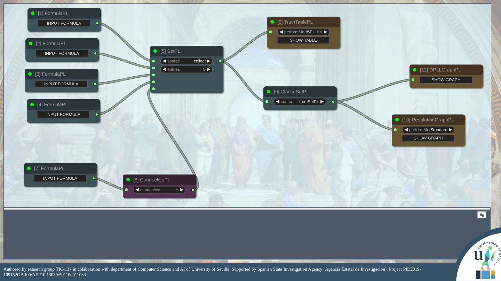
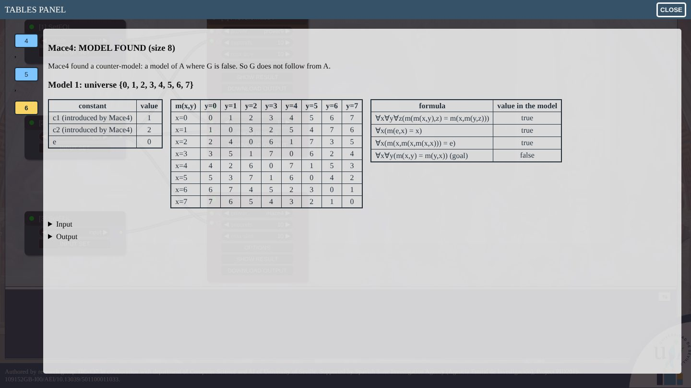

# LogicUS GUI

LogicUS is a visual environment for learning and practising propositional and first-order logic, developed at the
Department of Computer Science and Artificial Intelligence of the University of Seville. Formulas, sets, clauses and
the algorithms that work on them (normal forms, truth tables, semantic tableaux, resolution, DPLL, Herbrand models...)
are nodes of a graph: students build a *schema*, run it, and look at every intermediate result.



The algorithms are those of the Elm packages [logicus-pl](https://package.elm-lang.org/packages/logicUSLIB/logicus-pl/latest/)
and [logicus-fol](https://package.elm-lang.org/packages/logicUSLIB/logicus-fol/latest/), written to show how each step
is done. For problems too large for them, LogicUS also runs the automated provers Prover9, Mace4 and E, compiled to
WebAssembly so that they run in the browser: Mace4 counter-models are shown as tables, with the value of every
formula in them.



## Using it

LogicUS is a static web page: nothing is installed and nothing is sent to a server. Serve this folder with any web
server and open `LogicUS.html`, for instance:

```sh
python3 -m http.server 8000
# open http://localhost:8000/LogicUS.html
```

(Opening `LogicUS.html` directly as a file works for everything except the provers and the examples panel, which
browsers block for local files.)

Press the logo at the bottom right to show the menu. **EXAMPLES** opens ready-made schemas; drag nodes from the
right-click menu of the canvas (*Add Node*), connect them, and press **RUN NODE** on a node or **RUN SCHEMA** for all of them.
The panels show the tables and graphs produced by the nodes. **SAVE SCHEMA** and **LOAD SCHEMA** keep schemas as
JSON files.

| Group | Nodes |
|-------|-------|
| `LogicUS-PL` | formulas, sets, connectives, transformations and normal forms, clauses, Horn knowledge bases (forward and backward chaining), truth tables, semantic tableaux, resolution (several strategies), DPLL |
| `LogicUS-FOL` | formulas, sets, connectives and quantifiers, transformations (closures, prenex, Skolem, NNF, CNF, DNF), clauses, Herbrand universe, base, interpretations, models and extensions, semantic tableaux (with equality), resolution |
| `LogicUS-EXT` | propositional constraint satisfaction problems (to DIMACS and a SAT solver), variable forgetting, Prover9/Mace4 and E |

## Development

```
LogicUS.html            the page
js/LogicUSApp/          the nodes (LiteGraph) and the panels
js/LogicUSApp/AppCore.js  the Elm core, built from logicus-app-core/
logicus-app-core/       Elm application: runs the algorithms of logicus-pl and logicus-fol for the nodes
provers/                Prover9, Mace4 and E in WebAssembly, and how to rebuild them (see provers/README.md)
examples/               example schemas (examples/index.json lists them in the EXAMPLES panel)
tests/                  browser tests
```

The JavaScript side sends each node's request to the Elm core through a port and draws the answer.
`AppCore.js` is committed so that the page runs without a build step; after changing the Elm code, rebuild it with
[Elm 0.19.1](https://github.com/elm/compiler/releases/tag/0.19.1):

```sh
scripts/build-core.sh
```

The browser tests use [Playwright](https://playwright.dev):

```sh
npm install
npx playwright install
npm test
```

GitHub Actions checks that `AppCore.js` matches the Elm sources, runs the tests in Chromium, Firefox and WebKit, and
publishes the page on GitHub Pages (enable it in *Settings → Pages → Source: GitHub Actions*).

## Third-party components

| Component | Use | License |
|-----------|-----|---------|
| [LiteGraph.js](https://github.com/jagenjo/litegraph.js) | node graph editor | MIT |
| [MathJax](https://www.mathjax.org) 3.2.2 | formulas | Apache-2.0 |
| [D3](https://d3js.org) v3, [dagre-d3](https://github.com/dagrejs/dagre-d3), [graphlib-dot](https://github.com/dagrejs/graphlib-dot) | trees and graphs | BSD-3-Clause, MIT, MIT |
| [jQuery](https://jquery.com) 3.6.0 | | MIT |
| [FileSaver.js](https://github.com/eligrey/FileSaver.js) | downloads | MIT |
| sat.js | SAT solver of the CSP nodes | GPL-3.0-or-later |
| [Prover9 and Mace4](https://www.cs.unm.edu/~mccune/prover9/) (LADR) | provers, run as separate programs | GPL-2.0 |
| [E](https://eprover.org) | prover, run as a separate program | GPL-2.0-or-later |

## Credits

LogicUS is developed by the research group TIC-137 with the Department of Computer Science and Artificial
Intelligence of the University of Seville, supported by the Spanish State Research Agency (Agencia Estatal de
Investigación), project PID2019-109152GB-I00/AEI/10.13039/501100011033. Official site:
<https://logicus-es.github.io/>.
